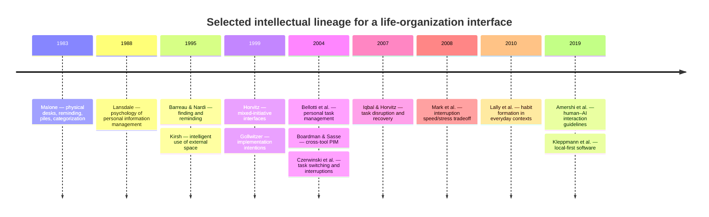

# Chapter 02 — Research foundations: from personal information management to interruption recovery

A useful history of this problem starts well before contemporary to-do applications.

**Personal organization is both finding and reminding.** Malone’s 1983 desk study is unusually important because it warns against copying the *surface metaphor* of paper organization while missing why people arrange paper that way. His interviews led to two especially durable observations: desk organization often reminds people about work they intend to do, and categorizing everything formally has cognitive costs; visible “piles” can therefore serve a legitimate function rather than merely representing disorder. 

Barreau and Nardi’s 1995 synthesis of two independent studies reached closely related conclusions in electronic environments. Their participants preferred location-based finding because of its reminding value, generally avoided elaborate filing schemes, archived relatively little, and operated with ephemeral, working, and archived information.  This matters for life organization because a perfectly normalized hierarchy can actually eliminate useful peripheral cues. A future task hidden flawlessly in `Life > Health > Dental > Administrative` may become easier to retrieve *if remembered* while becoming easier to forget altogether.

Lansdale’s 1988 *The Psychology of Personal Information Management* placed the problem explicitly in psychological terms and remains one of the canonical foundations of PIM research.  Later work expanded from files to activities distributed across tools. Bellotti and colleagues’ 2004 paper explicitly studied task management toward the design of a personal task-list manager, while Boardman and Sasse examined PIM across tools—the fragmentation problem signaled memorably by their title, *“Stuff goes into the computer and doesn’t come out.”* 

The resulting first principle is:

**A personal organizer should not merely make intentions retrievable; it should control when and how they become perceptible.**

That is a stronger requirement than search.

**External structure reduces mental bookkeeping.** Kirsh’s *The Intelligent Use of Space* is a canonical treatment of how spatial arrangements can become part of cognition rather than passive presentation.  In a life-organizer, that suggests a stable visual grammar in which proximity, grouping, persistence, and disappearance have semantic meaning. The interface should let the environment carry state that the person would otherwise rehearse mentally.

This connects to distributed-cognition work more broadly and to the practical lesson from Malone and Barreau/Nardi: the environment works partly because it preserves cues. An app that continually resorts, recolors, summarizes, and rewrites everything in the name of “AI optimization” can therefore damage cognition even while producing theoretically better rankings. Stable spatial or structural landmarks have value.

**Task switching is a state-reconstruction problem.** Czerwinski, Horvitz, and Wilhite’s week-long diary study was designed specifically to characterize how information workers interleave activities amid interruptions; its abstract reports both numerous switches and difficulty shifting among many tasks.  Their work also highlighted weak support for reinstating complex, long-running tasks—exactly the gap a title-only to-do item does not solve.

Iqbal and Horvitz then conducted an in-situ field study of task suspension and resumption using instrumentation that tracked active applications/windows plus incoming communication alerts. Their focus was not simply whether interruptions occurred, but what happened before suspension and during recovery.  Mark, Gudith, and Klocke’s later experiment emphasized a further subtlety: interruption effects cannot be reduced to “slower equals bad”; their study documented a speed/stress tradeoff, hence its title *The Cost of Interrupted Work: More Speed and Stress*. 

These findings suggest a different interaction primitive from “open task”:

> A substantive task should have a **working context that can be suspended and reinstated**.

The organizer should therefore model the state transition `Active → Parked → Resumable`, not just `Incomplete → Complete`.

**Remembering an intention differs from knowing a goal exists.** Work on prospective memory and goal activation—including Altmann and Trafton’s activation-based model of memory for goals—provides a useful conceptual explanation for why resumption cues and environmental triggers matter. Their canonical 2002 paper models goal representations as needing sufficient activation to guide behavior after interruptions. The product implication is straightforward: do not force the user to reconstruct “what was I doing?” from a project title.

Similarly, Gollwitzer’s implementation-intention work established the usefulness of linking anticipated situations to intended responses in an “if situation X, then action Y” form. That logic maps naturally to contextual triggers: *after breakfast → medication; arriving at grocery store → grocery action set; after closing work → tomorrow checkpoint.* It is a better model for some recurring behavior than indiscriminate clock reminders.

**Habits should be cue-centered rather than streak-centered.** Lally and colleagues asked participants to choose an eating, drinking, or activity behavior and repeat it daily in the same context for 12 weeks; increases in automaticity were then modeled over time.  The HCI implication is not that an app can “create habits” by displaying a streak. It is that the interface can support stable context–behavior associations, make repetition easy, and avoid unnecessarily disrupting the cue environment.

**Motivation is not synonymous with rewards.** Self-Determination Theory centers autonomy, competence, and relatedness as basic psychological needs; for a strictly single-user organizer, autonomy and competence are especially relevant to interaction design.  A system that constantly judges the user, silently rearranges plans, punishes missed streaks, or optimizes for “engagement” can conflict with those needs. An organizer should make the person feel more capable and more in control, not more managed.

**Automation should remain mixed-initiative.** Horvitz’s 1999 work on mixed-initiative interfaces was explicitly concerned with combining automated reasoning with direct manipulation rather than choosing one exclusively.  Amershi et al.’s later CHI work distilled and validated 18 human–AI interaction guidelines, organized around initial interaction, regular interaction, inevitable AI failures, and adaptation over time.  This is particularly important in life planning because “optimal” decisions depend on values, relationships, health, moods, tacit obligations, and private information that a ranking model will never fully observe.

The research can be condensed into a design-oriented map:

| Research strand | Core implication for a one-person organizer |
|---|---|
| Malone; Barreau & Nardi | Visibility and location can function as memory; organization is not only retrieval.  |
| Lansdale / PIM | Information organization imposes psychological costs as well as retrieval benefits.  |
| Bellotti; Boardman & Sasse | Task state and personal information span representations and tools; a task list alone does not unify the working environment.  |
| Kirsh / external cognition | Spatial and external structure can perform cognitive work rather than merely decorate information.  |
| Czerwinski et al. | Task switching and recovering complex activities deserve first-class interface support.  |
| Iqbal & Horvitz | Suspension and resumption should be treated as observable interaction states.  |
| Mark et al. | Interruption cost includes subjective load/stress, not merely elapsed task time.  |
| Gollwitzer / prospective action | Contextual action cues can bridge intentions and execution. |
| Lally et al. | Stable contexts and repetition matter for automaticity; habits are processes, not checkbox streaks.  |
| Ryan & Deci | Preserve user autonomy and support felt competence.  |
| Horvitz; Amershi et al. | Intelligent assistance should be legible, correctable, and subordinate to human intent.  |

