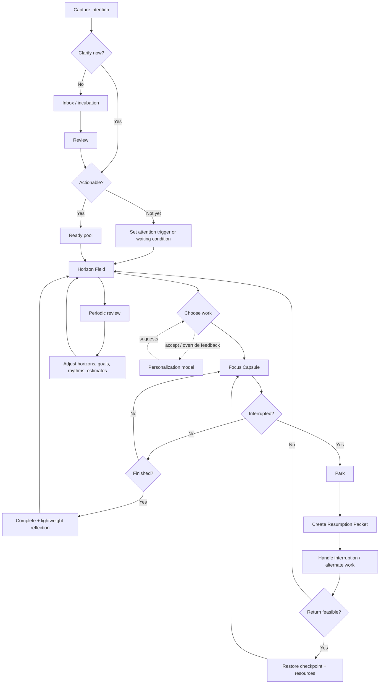

# Chapter 05 — Proposed interaction concept: the Horizon Field

The proposed view is called the **Horizon Field** because its organizing question is not “what date is this?” but:

> **At what attention horizon should this commitment live?**

The center is **Now**. Moving outward means “do not spend cognition on this yet.” Deadlines remain visible as constraints, but they do not determine the item’s geometric location by themselves.

A conceptual desktop sketch:

```text
┌──────────────────────────────────────────────────────────────────────────────┐
│ HORIZON FIELD          Sat Oct 3             capacity: balanced   [+ Capture]│
│                                                                              │
│                 ┌────────────── LATER ──────────────────┐                    │
│                 │  move research?     learn Spanish ~   │                    │
│                 │                                        │                    │
│                 │    ┌──────── NEAR ───────────────┐     │                    │
│                 │    │ tax documents    dentist     │     │                    │
│                 │    │ finish benchmark ~           │     │                    │
│                 │    │                              │     │                    │
│                 │    │  ┌──── TODAY ────────────┐   │     │                    │
│                 │    │  │ call Mom   walk ↻     │   │     │                    │
│                 │    │  │ groceries             │   │     │                    │
│                 │    │  │                       │   │     │                    │
│                 │    │  │ ┌────── NOW ───────┐  │   │     │                    │
│                 │    │  │ │ Parser refactor │  │   │     │                    │
│                 │    │  │ │ 35–60 min       │  │   │     │                    │
│                 │    │  │ │                 │  │   │     │                    │
│                 │    │  │ │ Resume cue:     │  │   │     │                    │
│                 │    │  │ │ inspect token   │  │   │     │                    │
│                 │    │  │ │ recovery; test  │  │   │     │                    │
│                 │    │  │ │ 14 reproduces   │  │   │     │                    │
│                 │    │  │ │                 │  │   │     │                    │
│                 │    │  │ │ [Done] [Park]   │  │   │     │                    │
│                 │    │  │ └─────────────────┘  │   │     │                    │
│                 │    │  └───────────────────────┘   │     │                    │
│                 │    └──────────────────────────────┘     │                    │
│                 └──────────────────────────────────────────┘                    │
│                                                                              │
│ NEXT FITS                                                                    │
│  1  Review PR         20–30m   same context                                  │
│  2  Grocery order     ~15m     window open                                   │
│  3  Tax documents     30–60m   deadline slack narrowing                      │
│                                                                              │
│ CAPACITY  Today [██████░░]  Tomorrow [████░░░░]  Week [█████░░░]             │
└──────────────────────────────────────────────────────────────────────────────┘
```

The rings need not literally remain circular in production. On a narrow mobile screen, the same semantics become stacked horizons:

```text
┌────────────────────────────┐
│ NOW                   +    │
│                            │
│ Parser refactor            │
│ 35–60 min                  │
│                            │
│ ↳ Resume                   │
│   test 14 reproduces       │
│   inspect token recovery   │
│                            │
│ [ Done ]      [ Park ]     │
├────────────────────────────┤
│ NEXT                       │
│ Review PR       20–30m     │
│ Grocery order   ~15m       │
│ Tax docs         30–60m    │
├────────────────────────────┤
│ TODAY  3 commitments       │
│ NEAR   moderate load       │
│ LATER  12 sleeping         │
├────────────────────────────┤
│ + quick capture            │
└────────────────────────────┘
```

The view uses **radial/vertical distance for exactly one important variable: attention horizon**. It avoids encoding priority, energy, urgency, certainty, domain, and effort through five simultaneous colors and shapes. Life domain can form optional sectors on desktop; deadline risk, uncertainty, recurrence, and waiting status use small textual badges. This keeps the representation learnable.

**The Focus Capsule** replaces the conventional selected-task detail pane. It answers four questions only:

1. What am I trying to accomplish?
2. What is the next executable move?
3. What context do I need to continue?
4. What should happen when I stop?

The distinction between task title and resume cue is essential. A title describes the object; the cue describes the current mental frontier.

For example:

```text
Outcome:     Ship parser error recovery
Current:     Reproduce unexpected EOF path
Checkpoint:  Test 14 reproduces only after nested ternary.
Next:        Inspect parse_expr() recovery branch.
Resources:   test_14.rs · parser.rs:441 · issue #318
Estimate:    likely 35m, could be 60m
```

When the user presses **Park**, that state becomes a Resumption Packet. The packet can be completely manual, automatically assisted, or a hybrid. Automatic capture must remain privacy-sensitive because application/window/document histories can reveal extremely personal information.

**The Next Fits surface** deliberately shows few choices. Candidate generation operates in two stages.

First, eliminate inappropriate work:

```text
not actionable yet
blocked dependency
wrong location/device
insufficient available window
deliberately sleeping
outside routine window
```

Then rank eligible actions according to current fit. The system shows at most perhaps three to five candidates by default, with a deliberate “See more” action. That constraint is a design choice intended to reduce decision work, not an assertion that five has a universally optimal cognitive value.

A suggestion might read:

```text
Review PR
20–30 min
Why now: same project context · fits before 3:00 appointment
```

The user can immediately choose something else. Choosing differently becomes personalization evidence; it is not treated as an “error.”

**The Capacity Ribbon** shows whether intentions plausibly fit available life capacity without demanding an exact calendar. Instead of:

```text
10:00–10:45 A
10:45–11:20 B
11:20–12:00 C
```

it can represent:

```text
Today      committed ██████░░   uncertainty ±
Tomorrow   committed ████░░░░
This week  committed █████░░░   one hard deadline
```

Calendar blocks remain available for genuinely clock-bound events and deliberate timeboxing. The Horizon Field does not abolish the calendar; it demotes the calendar from **universal ontology** to **one constraint source**. Sunsama’s own documentation implicitly acknowledges this distinction by offering both a calendar-bound timeboxing method and an ordered “playlist” for days when precise scheduling adds less value. 

**Uncertainty is visible but optional.** A user might enter `~30m`, `30–90m`, or nothing. The planner can learn empirical error distributions from prior work, but it should never manufacture unwarranted certainty. Hard versus soft deadlines should likewise differ:

```text
HARD   submit tax filing by Apr 15
SOFT   would like draft by Friday
IDEAL  exercise around lunch
WINDOW groceries any time after work
```

A planning surface can therefore say:

> “Friday looks safe if estimates are typical; tight if the parser work runs long.”

That is more honest than filling Friday’s remaining white space with blocks and presenting the result as settled.

**Rhythms replace streak-centric habits.** A rhythm defines a behavior, a cue/window, a desired frequency, and minimum acceptable form:

```text
Walk
Cue/window: after lunch, 11:30–14:30
Target: 5 days/week
Minimum viable: 10 min
Preferred: 30 min
```

The interface can show whether the rhythm is finding a stable place in life without declaring a missed Tuesday a broken identity. Reclaim’s flexible habit windows provide a contemporary example of routines moving within acceptable temporal bounds; the proposed design extends the idea beyond calendar occupancy into behavioral context and attention.  Lally et al.’s work provides the stronger behavioral reason to care about repeated context. 

**Long-term goals remain connected but peripheral.** Every commitment may optionally link upward:

```text
Action → Project/Outcome → Life direction/domain
```

For example:

```text
Run 25 min
  ↳ restore consistent cardiovascular training
      ↳ health / energy
```

The Focus Capsule normally displays only the action. During reflection, zooming outward reveals the outcome and direction. That avoids forcing abstract life-purpose language into every mundane action while preventing long-term aims from becoming disconnected inspirational documents.

**The interruption flow** is where this model differs most strongly from a conventional to-do/calendar combination.



The important state transition is not merely `Task A → Task B`. It is:

`Task A active → Task A checkpointed → interruption handled → Task A context restored`.

That design directly addresses the suspension/resumption problem documented in HCI interruption research. 

